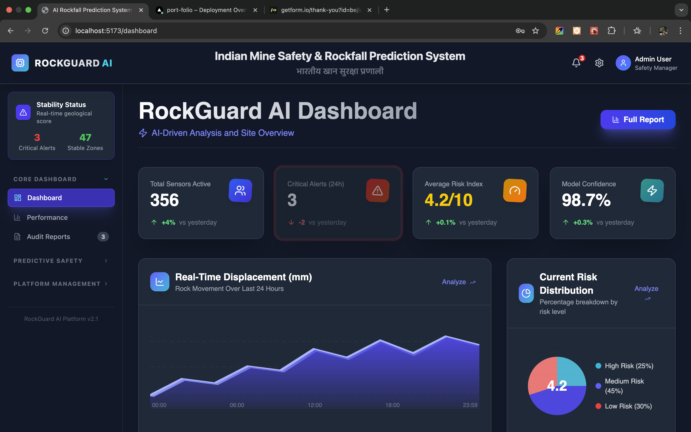

# DHARA

AI-powered early warning and safety monitoring for open-pit mines.
Built for the Smart India Hackathon (Problem ID 25071) by Team MANTHAN.



## About

DHARA turns live camera feeds into a 24/7 safety monitor. A Python backend uses OpenCV to detect hazards such as cracks and loose rocks, and a React dashboard shows the annotated video, risk levels, maps and alerts.

## Features

- Live webcam analysis with detections drawn on the video
- Image upload analysis
- AI risk prediction and trend charts
- Risk map of mine zones
- Alert system with SMS/WhatsApp templates (English and Hindi)
- Environmental monitoring, reports and activity log

## Tech Stack

- **Frontend:** React, Vite, Tailwind CSS, Recharts
- **Backend:** Python, Flask, OpenCV, NumPy

## Run Locally

**Backend**

```bash
cd backend
python -m venv venv
venv\Scripts\activate        # macOS/Linux: source venv/bin/activate
pip install -r requirements.txt
python app.py
```

Runs at http://localhost:5000

**Frontend** (new terminal, project root)

```bash
npm install
npm run dev
```

Runs at http://localhost:5173

**Demo login:** `admin@mineguard.com` / `admin123`

## Note

This is a prototype for demonstration. Dashboard data is simulated, and it should not be used as a certified safety system.


